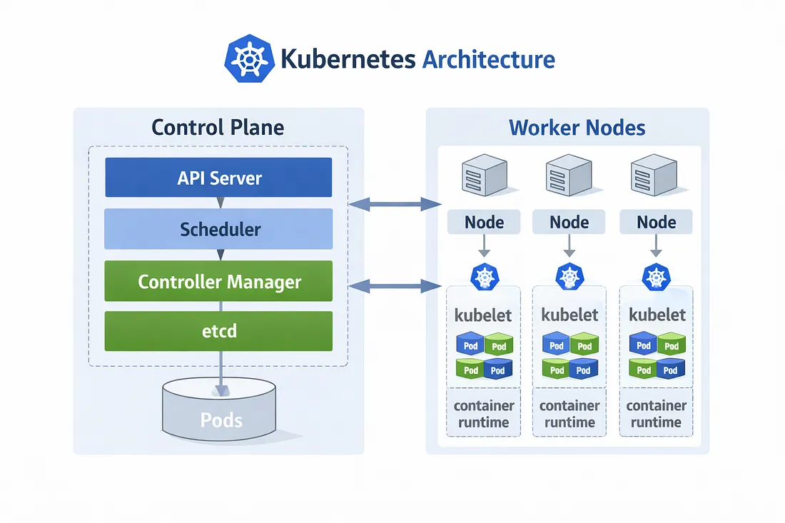

## **2. Kubernetes Architecture**

Kubernetes architecture consists of two main components:

1. **Control Plane** – Manages and controls the cluster.
2. **Worker Nodes** – Run the actual applications inside containers.

### **1. Control Plane**

Responsible for managing the entire Kubernetes cluster.

| Component          | Purpose                                      |
| ------------------ | -------------------------------------------- |
| API Server         | Entry point for all Kubernetes requests.     |
| Scheduler          | Decides which worker node should run a Pod.  |
| Controller Manager | Maintains the desired cluster state.         |
| etcd               | Stores cluster configuration and state data. |

### **2. Worker Node**

Responsible for running application workloads.

| Component         | Purpose                                                     |
| ----------------- | ----------------------------------------------------------- |
| Kubelet           | Ensures Pods are running as expected.                       |
| Kube-proxy        | Handles network communication and Service traffic routing.  |
| Container Runtime | Runs containers (e.g., containerd, CRI-O).                  |
| Pod               | Smallest deployable unit containing one or more containers. |

### **Example: Deploying a Spring Boot application**

1. You request deployment through the Kubernetes API.
2. API Server receives the request.
3. Scheduler selects a suitable worker node.
4. Kubelet ensures the Pod is created.
5. Container Runtime starts the Spring Boot container.
6. Kubernetes continuously monitors the desired state.

**Remember for interviews:**

- Control Plane = Brain of Kubernetes.
- Worker Node = Runs applications.
- Pod = Runs containers.
- etcd = Stores cluster information.

---

### **Virtual Network in Kubernetes**

A **Virtual Network in Kubernetes** enables communication between Pods, Services, and external clients across different worker nodes.

Kubernetes uses a networking model where:

1. Every Pod gets its own IP address.
2. Pods can communicate with other Pods directly, even across different nodes.
3. Services provide a stable IP address and DNS name to access Pods.
4. Network plugins (CNI – Container Network Interface) implement Pod networking.

**Example:**

Suppose you have:

- React frontend Pod
- Spring Boot backend Pod
- MySQL database Pod

All three Pods can communicate through the Kubernetes virtual network.

**Important terms:**

- **Pod Network:** Enables Pod-to-Pod communication.
- **Service Network:** Provides stable access to Pods.
- **CNI:** Plugin responsible for implementing container networking.

**In simple words:** Kubernetes virtual networking allows different Pods and Services to communicate regardless of which worker node they run on.